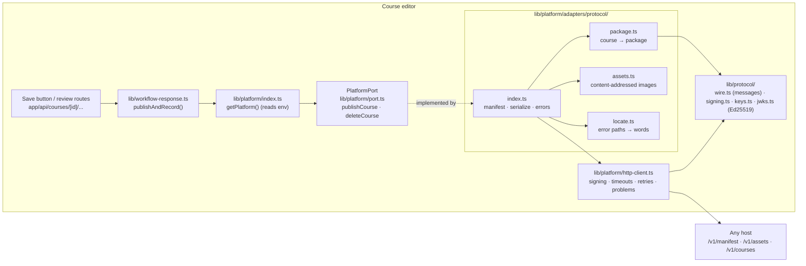

# Platform integration (publishing)

Last updated: 2026-10-05. Replaces the inara-next admin-API adapter (kept in git history on the
`wip/clerk-publish` branch).

The editor publishes courses through the **Course Publishing Protocol**, which the editor owns and
any host platform implements: [contract/README.md](../contract/README.md) is the spec. The editor
contains **no host-specific code**: no host URLs, ids, enums, rules or login. inara-next is one
host; a FastAPI service could be another, with no change to the editor.

- **Autosave** writes only the editor's local JSON files.
- **Save** (or Ctrl/⌘+S) saves locally, then publishes the whole course in **one signed request**.
  The host applies it in **one transaction**: a publish happens completely or not at all.
- **Review actions** (submit, withdraw, accept / reject / request changes) publish the new status.
- **Deleting** a course deletes it on the host first; if that fails, the course stays in the editor.
- If publishing fails, the local save still stands, and the Save bar or status panel shows why,
  down to the lesson, section and block when the host says where the problem is.

---

## 1. Design



- **The editor depends only on `PlatformPort`.** Nothing outside `lib/platform/` knows publishing
  exists beyond `publishCourse` and `deleteCourse`.
- **The protocol is the contract, not a host's API.** `lib/protocol/wire.ts` defines every
  message; `contract/schemas/*.schema.json` are generated from it (`npm run contract:generate`,
  checked by `npm run contract:check`) for hosts in other languages.
- **One request per publish.** The package carries the whole course (structure, content, review
  status) keyed by the editor's UUIDs. The host keeps the mapping to its own ids, so the editor keeps
  **no link files** and can't create duplicates by losing one.
- **Images are content-addressed** (id = SHA-256 of the bytes). The editor asks the host whether it
  has an image and uploads it only if not. Hosts without file storage say so in their manifest and
  the editor links images from `EDITOR_PUBLIC_URL`.
- **The host negotiates.** `GET /v1/manifest` says which protocol major it speaks, which block types
  it can show (lessons using others keep their last published version, with a warning), and its
  limits. It is cached for five minutes.
- **One publish per course at a time**, in order, so an older version can never land after a newer
  one.
- **Errors come back as problems** (RFC 9457) with a `code` and paths into the package; the adapter
  turns them into the editor's own kinds (`invalid`, `conflict`, `auth`, `unavailable`,
  `not_configured`) and readable issues ("Lesson “Intro” in module “Basics”, section 2, block 1
  (mcq): …").

### Authentication

Protocol 2.0: **nothing secret is shared.** The editor signs requests with its own Ed25519 private
key (`EDITOR_PRIVATE_KEYS`) over the timestamp, method, path and body hash (`X-Signature-Key-Id`,
`X-Signature-Timestamp`, `X-Signature`; details in the contract). The host checks them against the
editor's public keys at `/.well-known/jwks.json`. The host signs launch tokens and events with its
own key, which the editor checks against the host's JWKS (`PLATFORM_JWKS_URL`, default
`<PLATFORM_URL>/v1/jwks`). Each side rotates its own key: new key first, deploy, drop the old one.
Rotating the host's key signs every editor user out.

The signature identifies **the editor installation**. The package's `actor` is the person who pressed Save
or made the decision: their **host** user id, name and email, from the launch token they signed in
with. Hosts check it on every publish (inara-next: creators and admins may publish, only admins may
approve, reject or request changes).

### Sign-in and roles

With a platform connected (`PLATFORM_ADAPTER=protocol`), the editor has **no accounts of its own**.
People sign in on the platform and open the editor from there (contract § Launch):

1. The platform shows its Course editor link only to people it lets in (inara-next: members an admin
   made **creators**, and **admins**).
2. Clicking it makes the platform sign (with its own Ed25519 key) a 60-second, single-use launch
   token and POST it to the editor's `/launch` (`app/launch/route.ts`). The token lists the user's
   organizations with their role in each (`orgs`), and whether they're platform staff (`staff`:
   inara-next sets it for admins of the inaraX organization).
3. The editor checks it (`lib/protocol/launch.ts`, replay guard `lib/launch-replay.ts`), records the
   user and **mirrors their organizations** as workspaces (`lib/authz/identity.ts`: an organization
   missing from the token is one they left, and its workspace goes), then starts a **session stored
   in the database** (`lib/session.ts`): the cookie is a random token. A session ends on sign-out,
   after 8 hours, after 30 idle minutes, when the platform sends `user.access_changed` (role or
   organizations changed), or when the platform key that signed its launch is rotated away.
   Reviewers land on `/admin`, everyone else on `/dashboard`.
4. `proxy.ts` (with `lib/auth-gate.ts`) turns away requests without a session (pages go to
   `/signed-out`, APIs get 401). Every page and route then loads the user's workspaces and roles from
   the database (`lib/authz/context.ts`) and asks `lib/authz/policy.ts` whether the action is
   allowed. A course in a workspace the user isn't in answers 404, never 403.
5. Course and lesson queries run in transactions scoped to the user's workspaces
   (`lib/db/tenant-db.ts`), and Postgres row-level security checks the same scope on every row, so a
   query that forgets its filter still can't reach another workspace.

| Workspace | Role | Can |
|---|---|---|
| personal (everyone has one) | owner | Create courses, edit and publish their own, submit for review, withdraw |
| | platform staff | Read, edit (as reviewer), accept, reject and request changes, in every personal workspace |
| organization | creator | Create courses there; work on their own (others' courses are invisible) |
| | admin | Everything on every course in that organization, including review; submit only their own |

Reviewers edit from the review area (`/admin`): edits there are allowed during review and don't
change the status. Someone who wrote a course and also reviews it (an org admin's own course) gets
creator rules in the creator pages and reviewer rules in `/admin`.

When the platform changes someone's role or organizations it sends a signed `user.access_changed`
event (`app/api/platform/events/route.ts`); the editor ends all of that person's sessions, so their
next click asks them to sign in again and the new launch records the new access. The platform's
actor check still refuses publishes they're no longer allowed to make. **Sign out** (header) ends the
editor session and then sends the browser to the platform's `logout_url`, which signs them out
there too, so "Open the platform" doesn't sign them straight back in. Protocol 2.0 needs a 2.x
platform; 1.x platforms (shared HMAC secret) are no longer supported.

Without a platform (`PLATFORM_ADAPTER=none`, local work), there is no sign-in: one local user who
owns a personal workspace and also reviews it, so `/admin` works as before.

---

## 2. Configuration

Put these in `.env.local` (see `.env.example`):

| Variable | Meaning |
|---|---|
| `PLATFORM_ADAPTER` | `protocol` to publish, `none` (default) to only save locally |
| `PLATFORM_URL` | The host's protocol base URL. inara-next: `<inara-next URL>/api/integrations/course-editor`. Must be https except for localhost |
| `EDITOR_PRIVATE_KEYS` | The editor's own Ed25519 private keys, JSON list of JWKs, active first (`npm run keys:generate`) |
| `PLATFORM_JWKS_URL` | Optional: the host's public keys, if not `<PLATFORM_URL>/v1/jwks` |
| `EDITOR_PUBLIC_URL` | This editor's public address, for images the host can't store |

Wrong or missing settings make Save answer "publishing isn't set up" with the exact variable at
fault, never a crash.

---

## 3. Connecting to inara-next

inara-next implements the protocol in `app/api/integrations/course-editor/v1/` and
`lib/integrations/course-editor/` (its `docs/course-editor-integration.md` has the details). On the
inara-next side set:

```
COURSE_EDITOR_PRIVATE_KEYS='[…]'                 # inara-next's own Ed25519 key(s): npm run course-editor:keys
COURSE_EDITOR_URL=<this editor's public address>  # Course editor tabs, sign-in, and where it reads our public keys
COURSE_EDITOR_ORGANIZATION_ID=<org id>            # optional; personal-workspace courses (default: inaraX)
```

How inara-next maps a package (for reference; the editor doesn't depend on it):

| Editor | inara-next |
|---|---|
| course / module / lesson UUID | `courses.uuid` / `modules.uuid` / `lessons.uuid` (same value) |
| level 1–3 | `levels.level_number` 1–3 |
| lesson content | the English canonical `generated_lessons.structured_content` |
| `draft` / `in_review` / `changes_requested` / `approved` / `rejected` | course `DRAFT` / `UNDER_REVIEW` / `CHANGES_REQUESTED` / `PUBLISHED` (see below) / `REJECTED`; lessons `DRAFT` / `PENDING_REVIEW` / `REJECTED` (with comments) / `APPROVED` / `REJECTED` |
| `course.organization.host_org_id` (from the workspace; `null` for personal) | the course's organization link (`null`: `COURSE_EDITOR_ORGANIZATION_ID`, default inaraX) |

**Approval goes live.** An `approved` package from an org admin or staff becomes `PUBLISHED`, so
learners in that organization see it on `/courses`. Without a cover image it stays `APPROVED` and the
host returns a warning naming what's missing. While a course is `PUBLISHED`, packages that aren't
`approved` don't change its content (a warning says the live version stays until re-approval), so
unreviewed edits never reach learners. `RETIRED` is set in inara-next only.

Moving a lesson or module now **moves** it on inara-next (learner progress stays), instead of the
old delete-and-recreate.

### Local testing

1. In inara-next, run `npm run course-editor:keys` and put the printed key in `.env` as
   `COURSE_EDITOR_PRIVATE_KEYS`, add `COURSE_EDITOR_URL=http://localhost:3001`, and run it
   (`npm run dev`, port 3000).
2. In the editor, run `npm run keys:generate`, and in `.env.local`:
   ```
   PLATFORM_ADAPTER=protocol
   PLATFORM_URL=http://localhost:3000/api/integrations/course-editor
   EDITOR_PRIVATE_KEYS='[{"kty":"OKP","crv":"Ed25519",…}]'   # from keys:generate
   ```
   Each side finds the other's public keys itself (JWKS); no secret is copied between them.
   Without inara-next, `npm run dev:launch` is a stand-in platform (sign-in, key rotation,
   access changes).
3. `npm run dev -- -p 3001`. Opening <http://localhost:3001> now shows "signed out".
4. In inara-next, as an admin, click **Course editor** in the sidebar (a new tab opens, signed in as
   admin). To try the creator side, make a user a **Creator** on Admin → Team Directory and open the
   editor from their sidebar. With inara-next's dev auth bypass, `DEV_AUTH_USER=admin` or `student`
   picks who you are.

### Checking a host

`npm run verify-host` runs the protocol's conformance checks (auth, manifest, assets, create,
idempotency, moves, title swaps, removal, validation errors, rollback, actor check, delete) against a
running host with `PLATFORM_URL` and `EDITOR_PRIVATE_KEYS` plus `PLATFORM_ACTOR_ID`: the platform user id
of an admin (inara-next: `users.uuid`). Use a development host: it creates and deletes a test course.

---

## 4. Tests

`npm test` runs the unit tests:

- `tests/protocol/signing.test.ts`: signing, tampering, clock skew, rotation, and the published test
  vectors.
- `tests/platform/package.test.ts`: building packages, unsupported blocks, locating errors.
- `tests/platform/protocol-adapter.test.ts`: the adapter against an in-memory host
  (`tests/helpers/fake-host.ts`) that verifies signatures like a real one.
- `tests/platform/env.test.ts`: configuration checks.

---

## 5. Known gaps

- **Courses created before sign-in** are owned by `user_local_creator`, so no creator sees them;
  admins see every course. To hand one to a creator, set `owner_id` in its `course/<id>/course.json`
  to their platform user id (inara-next: `users.uuid`).
- **Single editor process**: the launch-token replay guard is in memory, which fits how the editor
  runs (one process, data on local disk). Several instances would need a shared store.
- **Preview** still uses the copied inara-next player in `vendor/inara-player/` (later phase: the
  host renders previews; the copy stays as an offline fallback). The protocol already has a
  `capabilities.preview` flag for it.
- **Revision ordering** is enforced by the editor (one publish per course at a time). The package
  carries `revision`; inara-next doesn't store it yet, so two separate editor installations
  publishing the same course could still overwrite each other.
- **Content added in inara-next to an editor course** (modules or lessons created in inara-next's
  admin) is removed on the next publish: the editor is the source of truth for its courses. The
  publish result warns when a removed lesson had learner completions.
